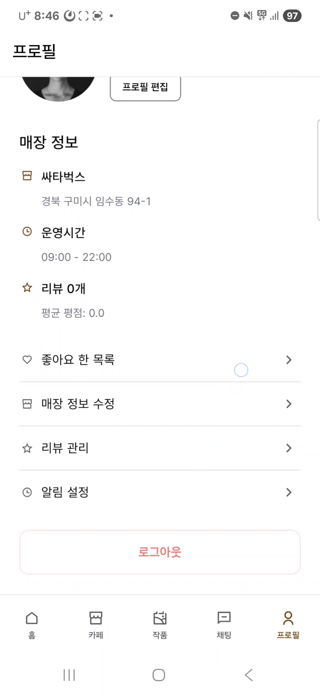

# 시연 시나리오

### 1단계: 카페 공간 등록 (카페 사장)

**0. 카페 사장 화면에서 공간 등록을 누른다.**

---

**1. 공간 등록을 눌러 카메라로 전시 공간 크기를 측정한다.**
- AR 카메라를 활용하여 실제 공간의 벽면을 측정합니다.

---

**2. 측정이 완료되면 2차원 도면이 생성된다.**
- 측정된 데이터를 바탕으로 자동으로 평면도가 생성됩니다.

---

**3. 각 벽에 높이를 설정할 수 있다.**
- 생성된 도면에서 각 벽면의 높이를 입력합니다.

---

**4. 전시 공간 높이를 측정한다.**
- AR을 통해 벽면의 실제 높이를 측정합니다.

---

**5. 높이 측정이 완료된 도면의 모습**
- 너비와 높이가 모두 입력된 완성된 도면을 확인할 수 있습니다.

---

### 2단계: 작가 로그인 및 카페 매칭

**6. 공간 측정 시연이 완료되었으면 프로필 탭의 로그아웃 버튼을 누르고 작가 계정으로 로그인한다.**

---

**7. 작가 홈화면에서 카페 매칭을 누른다.**
- AI 추천 기반 카페 매칭 서비스를 시작합니다.

---

**8. 카페 매칭을 눌러 추천 받을 작품을 선택한다.**
- 전시하고 싶은 작품을 선택합니다.

---

**9. 작품 누르면 하단에 선택한 거 보인다. 다음 버튼 클릭**
- 선택된 작품이 하단 바에 표시되며, 다음 단계로 진행합니다.

---

**10. 추천된 카페를 확인할 수 있다. 상세 보기 클릭**
- AI가 작품에 어울리는 카페를 추천하며, 드래그로 다른 추천 카페도 확인 가능합니다.

---

### 3단계: 카페 검색 및 상세 정보

**11. 카페 상세 정보를 확인할 수 있다. 뒤로가기 후 지도 탭 이동**
- 카페의 위치, 전시 슬롯, 리뷰 등 상세 정보를 확인합니다.

---

**12. 근처 카페를 지도, 마커로 나타낸다. 민다방 검색**
- 지도 화면에서 근처 카페들이 마커로 표시되며, 검색창에서 원하는 카페를 검색합니다.

---

**13. 민다방이라는 카페 검색결과 보여준다. 민다방 클릭**
- 검색 결과에서 민다방 카페를 선택합니다.

---

**14. 민다방 상세화면의 전시슬롯 화면이다. 문의 버튼 클릭**
- 카페의 전시 슬롯 현황과 도면을 확인하고 문의하기 버튼을 클릭합니다.

---

### 4단계: 채팅 및 매칭 요청

**15. 채팅화면. 좌측 하단 플러스 버튼 클릭**
- 카페 사장과의 채팅방에서 플러스 버튼을 눌러 매칭 요청을 시작합니다.

---

**16. 매칭요청 클릭**
- 하단 메뉴에서 매칭요청을 선택합니다.

---

**17. 전시 일정 선택**
- 전시 시작일과 종료일을 선택합니다.

---

**18. 전시 슬롯 선택**
- 카페의 전시 가능한 벽면(슬롯)을 선택합니다.

---

**19. 작품 선택**
- 전시할 작품을 선택합니다.

---

**20. 수수료 선택**
- 전시 수수료 비율을 선택합니다.

---

**21. 추가 요청사항 입력**
- 카페 사장에게 전달할 추가 요청사항을 입력하고 매칭 요청을 전송합니다.

---

**22. 매칭 요청 완료**
- 매칭 요청이 성공적으로 전송되었습니다.

---

### 5단계: 매칭 수락 및 리뷰

**23. 매칭 수락 완료. 뒤로 가기 후 전시 종료된 채팅방으로 이동**
- 카페 사장이 매칭을 수락하면 전시가 확정됩니다. (데모에서는 이미 종료된 전시 채팅방으로 이동)

---

**24. 매칭 후 전시 종료 UI 리뷰하기 클릭**
- 전시가 종료되면 채팅방에 리뷰 작성 UI가 표시됩니다.

---

**25. 리뷰 입력. 리뷰 제출 클릭**
- 별점과 리뷰 내용을 작성하고 제출합니다.

---

**26. 리뷰 완료 결과**
- 리뷰가 성공적으로 등록되었습니다.

---